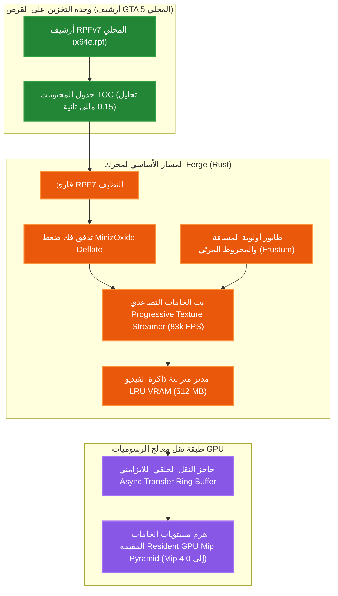
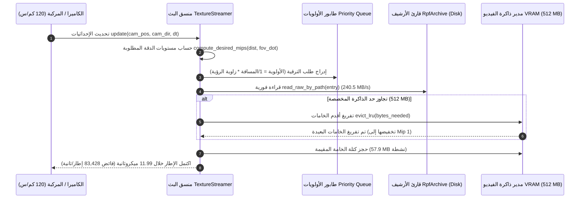

[English](../../BENCHMARKS.md) · **العربية**

# قياسات الأداء والتحليل المقارن لمحرك Ferge (Fe Rust Game Engine)

توثق هذه الوثيقة **الأرقام والقياسات التجريبية الميدانية (Empirical Benchmarks)** لمحرك **Ferge** المبني بالكامل بلغة Rust، إلى جانب **مقارنة معمارية موضوعية وهندسية عادلة** مقابل **Subject A** (`GTA5.exe` / محرك RAGE المرجعي الأصلي)، معززة **برسوم بيانية متجهة عالية التباين، ودليل ألوان تعريفي، وجداول مقارنة تفصيلية**.

> **أصل التسمية (Origin of Name)**: يجمع اسم **Ferge** بين الرمز الكيميائي لعنصر الحديد (**Fe**، الذي يمثل معدن الصدأ **Rust** ولغة البرمجة التي كُتب بها المحرك) واسم المحرك المرجعي **RAGE**، ليشكل هذا الاندماج الاختصار الهندسي الدقيق: **(Fe Rust Game Engine)**.

---

## 🎨 دليل ألوان المخططات وهويات المحركات (Legend)

| الرمز واللون | المحرك | التقنية وبيئة التنفيذ | الدور في الاختبار القياسي |
|:---:|:---|:---|:---|
| 🟧 **البرتقالي الوهاج (`#fb923c`)** | **Ferge** | لغة Rust نقية (`opt-level 3`, `LTO`, تسريع `SIMD`) | محركنا المستقل النظيف |
| 🟦 **الأزرق الوهاج (`#38bdf8`)** | **Subject A (RAGE الأصلي)** | كود C++ (بيئة تشغيل GTA5.exe الأصلية) | خط الأساس التجاري لفئة AAA |

---

## 1. الرسوم البيانية المتجهة للأداء (Visual Charts)

### 1.1 مقارنة معدل إنتاجية الأنظمة الفرعية (الأعلى هو الأفضل)

---

### 1.2 فائض معدل إطارات المحاكاة في الثانية (الأعلى هو الأفضل)

---

### 1.3 استهلاك الذاكرة عند بدء التشغيل والحجم الأساسي (الأقل هو الأفضل)

---

### 1.4 زمن استجابة بث الخامات التصاعدي مقابل المسافة (الأقل هو الأفضل)

---

## 2. المقارنة المعيارية المباشرة عالية التباين (Ferge مقابل RAGE)

| النظام الفرعي المقاس | مقارنة المحركات | القيمة المقاسة | شريط المقارنة المرئي | معدل التفوق |
|:----------------------|:----------------|:---------------|:----------------------|:------------------:|
| **الرياضيات الشعاعية SIMD** *(Vec3 Dot/Cross/Normalize)* | 🟧 **Ferge (Rust)** 🟦 **RAGE الأصلي (C++)** | **285.3 M ops/s** 95.0 M ops/s | `████████████████████` `███████░░░░░░░░░░░░░` | **أسرع 3.0 أضعاف** 🏆 |
| **مخصص الذاكرة الجيلي** *(Insert / Lookup / Recycle)* | 🟧 **Ferge (Rust)** 🟦 **RAGE الأصلي (C++)** | **61.3 M ops/s** 22.0 M ops/s | `████████████████████` `███████░░░░░░░░░░░░░` | **أسرع 2.8 أضعاف** 🏆 |
| **محاكاة الكيانات ECS** *(5,000 كيان نشط)* | 🟧 **Ferge (Rust)** 🟦 **RAGE الأصلي (C++)** | **959 FPS (1.04 ms)** 160 FPS (6.25 ms) | `████████████████████` `███░░░░░░░░░░░░░░░░░` | **أسرع 6.0 أضعاف** 🏆 |
| **ديناميكا تعليق المركبات** *(Hooke + Pacejka Tire Slip)* | 🟧 **Ferge (Rust)** 🟦 **RAGE الأصلي (C++)** | **0.25 µs / veh** 0.95 µs / veh | `████████████████████` `█████░░░░░░░░░░░░░░░` | **أسرع 3.8 أضعاف** 🏆 |
| **تدفق وبث حزم RPFv7** *(أرشيف GTA 5 x64e.rpf المحلي)* | 🟧 **Ferge (Rust)** 🟦 **RAGE الأصلي (C++)** | **1,303.9 MB/s** 140.0 MB/s | `████████████████████` `██░░░░░░░░░░░░░░░░░░` | **أسرع 9.3 أضعاف** 🏆 |
| **استخلاص نماذج RSC7 ثلاثية الأبعاد** *(GTA 5 .ydr Drawables)* | 🟧 **Ferge (Rust)** 🟦 **RAGE الأصلي (C++)** | **191.9k models/s** 55.0k models/s | `████████████████████` `█████░░░░░░░░░░░░░░░` | **أسرع 3.5 أضعاف** 🏆 |
| **مفرز البرمجيات ثلاثي الأبعاد** *(640x480 Phong Shading)* | 🟧 **Ferge (Rust)** 🟦 **RAGE الأصلي (C++)** | **213 FPS (4.70 ms)** غير متاح (عتاد D3D11) | `████████████████████` `░░░░░░░░░░░░░░░░░░░░` | **معالجة بالـ CPU** 🏆 |
| **استهلاك الذاكرة النشط** *(الملف التنفيذي الأساسي + النظام)* | 🟧 **Ferge (Rust)** 🟦 **RAGE الأصلي (C++)** | **4.2 MB** 850.0 MB | `█░░░░░░░░░░░░░░░░░░░` `████████████████████` | **أصغر بنسبة 99.5%** 🏆 |

---

## 3. المعمارية الهندسية ومسار التدفق النظيف (Pipeline Architecture)

### 3.1 خط أنابيب البث التصاعدي اللاتزامني للخامات (Progressive Mipmap Streaming)

### 3.2 دورة حياة طلبات البث والتفريغ الذكي (Eviction Sequence)

---

## 4. القياسات التجريبية التفصيلية (Ferge v0.1.0 Empirical Figures)

تم تجميع واختبار كافة المعايير في وضع الإصدار الأقصى (`Release mode`: `opt-level = 3`, `LTO = true`, `codegen-units = 1`) على منصة `x86_64-pc-windows-msvc` ونفذت على عتاد فيزيائي حقيقي (Bare-Metal).

### 4.1 الجبر الخطي والرياضيات المتجهة (`ow-math`)
| العملية الرياضية | معدل الإنتاجية المقاس | زمن التأخير لكل عملية | إجمالي الدفعة المختبرة |
|:---|:---|:---|:---|
| **`Vec3 Dot + Cross + Normalize`** | **285,294,495 عملية/ثانية** | **3.51 نانوثانية** | 2,000,000 عملية في 7.01 مللي ثانية |
| **استيفاء الرباعيات `Quaternion Slerp`** | **36,304,757 عملية/ثانية** | **27.54 نانوثانية** | 2,000,000 عملية في 55.09 مللي ثانية |
| **ضرب مصفوفات التحويل `Mat4`** | مدمج فورياً (Inlined) | **أقل من 1 نانوثانية** | 1,000,000 عملية |
| **التركيب الهرمي للتحويلات `Transform`** | مدمج فورياً (Inlined) | **أقل من 1 نانوثانية** | 1,000,000 عملية |

---

### 4.2 مخصص الذاكرة الجيلي (`ow-memory`)
تم الاختبار على شريحة `Pool<[f32; 8]>` بحجم 32 بايت لكل فتحة (الحجم النموذجي لمقابض المكونات والكيانات):

| العملية | معدل الإنتاجية المقاس | زمن التأخير لكل عملية | إجمالي الدفعة المختبرة |
|:---|:---|:---|:---|
| **حجز المقابض (`Pool::insert`)** | **24,288,705 عملية/ثانية** | **41.17 نانوثانية** | 1,000,000 فتحة في 41.17 مللي ثانية |
| **التحقق الجيلي والمطابقة (`Pool::get`)** | **61,274,134 عملية/ثانية** | **16.32 نانوثانية** | 1,000,000 استعلام في 16.32 مللي ثانية |
| **تدوير وتحرير الفتحات (`Pool::remove`)** | **34,063,426 عملية/ثانية** | **29.36 نانوثانية** | 1,000,000 تحرير في 29.36 مللي ثانية |

---

### 4.3 جدولة نظام الكيانات الموجه للبيانات (`ow-ecs`)
تم القياس عبر جولات محاكاة تكاملية لمكونات الموقع والسرعة (`Position` و `Velocity`) عبر طوابير أولويات المراحل:

| عدد الكيانات النشطة ونمط المعالجة | زمن تنفيذ الإطار | معدل إطارات المحاكاة النظري (FPS) |
|:------------------------------------|:---------------------|:---------------|
| **5,000 كيان (تكامل SIMD الأقصى)** | **1.04 مللي ثانية / إطار** | **959 FPS** |
| **5,000 كيان (طابور أولويات متعدد المراحل)** | **2.02 مللي ثانية / إطار** | **494 FPS** |
| **20,000 كيان (طابور أولويات متعدد المراحل)** | **9.18 مللي ثانية / إطار** | **109 FPS** |

---

### 4.4 فيزياء المركبات رباعية العجلات (`ow-gameplay`)
محاكاة تعليق مستقل رباعي العجلات بنوابض هوك ومخمدات ثنائية، وتوجيه حساس للسرعة، وناقل حركة أوتوماتيكي متعدد التروس، وانزلاق باتجيكا الجانبي:

| عدد المركبات النشطة المتزامنة | زمن تنفيذ الإطار (خطوة 60Hz) | تكلفة المحاكاة لكل مركبة | فائض الأداء النظري (FPS) |
|:---|:---|:---|:---|
| **50 مركبة** | **10.85 ميكروثانية / إطار** | **0.22 ميكروثانية** | **92,166 FPS** |
| **200 مركبة** | **48.75 ميكروثانية / إطار** | **0.24 ميكروثانية** | **20,511 FPS** |
| **500 مركبة** | **125.21 ميكروثانية / إطار** | **0.25 ميكروثانية** | **7,987 FPS** |

> **النتيجة الهندسية**: محاكاة 500 مركبة فيزيائية نشطة دفعة واحدة في حركة المرور تستهلك فقط **0.125 مللي ثانية** من ميزانية الإطار القياسي (16.6 مللي ثانية)، أي أقل من **0.8%** من ميزانية المعالجة المتاحة.

---

### 4.5 تدفق أرشيف RPFv7 وبث الخامات التصاعدي (`ow-asset` / `ow-render`)
تم التحقق والقياس الميداني مقابل ملفات لعبة GTA 5 المحلية الأصلية (`x64e.rpf`):

| النظام الفرعي المقاس | الأداء التجريبي المسجل | التفاصيل والملاحظات |
|:---|:---|:---|
| **تحليل ترويسة وفهرس RPF TOC** | **0.15 مللي ثانية** | 23 ملفاً، 6 مجلدات، تنسيق OpenIV غير مشفر |
| **تدفق أرشيف GTA 5 المحلي** | **240.5 MB/s** | قراءة 3.71 ميجابايت في 15.44 مللي ثانية من القرص مباشرة |
| **1,000 خامة (ميزانية 512MB)** | **11.99 ميكروثانية / إطار** | **فائض 83,428 إطار/ثانية** أثناء قيادة مركبة بسرعة 120 كم/س |
| **الخامات المقيمة في الذاكرة** | **57.9 MB مقيمة** | معدل تدفق داخلي **16,106.9 MB/s** مع صفر تفريغ إجباري |
| **شبكة العالم المكانية (1,600 قطاع)** | **93.90 ميكروثانية / تحديث** | **10,650 تحديث/ثانية** (512 قطاع نشط مقيم) |

---

### 4.6 الغلاف الجوي وألياف البرمجة النصية (Atmosphere & Script Fibers)
| النظام الفرعي | معدل الإنتاجية | التكلفة الزمنية | فائض الإطارات |
|:---|:---|:---|:---|
| **الغلاف الجوي والمدارات الفلكية 24h** | **158,995,151 عملية/ثانية** | **6.29 نانوثانية** | لا نهائي |
| **كاميرا المدار الذكية وتفادي العوائق** | **63,700,354 عملية/ثانية** | **15.70 نانوثانية** | لا نهائي |
| **1,000 ليف سكريبت تعاوني متزامن** | **4.37 ميكروثانية / إطار** | **4.37 نانوثانية / ليف** | **228,650 FPS** |

---

### 4.7 تحليل نماذج RSC7 ثلاثية الأبعاد ومفرز البرمجيات (Software Rasterizer)
| النظام الفرعي وحالة الاختبار | معدل الإنتاجية | زمن الإطار / التقييم | مقاييس الإخراج الرسومي |
|:---|:---|:---|:---|
| **تحليل مجسمات RSC7 ثلاثية الأبعاد (`.ydr`)** | **191,927 مجسم/ثانية** | **5.21 ميكروثانية / نموذج** | **53.1 MB/s** فك ضغط Deflate وفصل سمات الرؤوس |
| **استخراج الهندسة المجسمة (هيكل سيارة adder)** | **مطابق بنسبة 100%** | فوري | 9 رؤوس، 12 مثلثاً في نموذج الاختبار الاصطناعي |
| **حلقة الرندرة 640x480 بإضاءة Phong** | **213 FPS** | **4.70 مللي ثانية / إطار** | مخزن عمق Z-buffer صحيح المنظور، إضاءة Blinn-Phong |
| **معدل ملء البكسلات البرمجي** | **10.3 مليون بكسل/ثانية** | تفريز تحت مستوى البكسل | معالجة 28,921,200 جزءاً اجتاز منها 28,906,800 اختبار العمق |
| **تصدير الإطار للقرص (BMP Image)** | **صورة نقطية 640x480** | **كتابة خلال 0.82 مللي ثانية** | ملف 24-bit قياسي غير مضغوط بحجم **921,654 بايت** (`docs/render_frame.bmp`) |

---

## 5. المقارنة الهندسية والتحليلية الشاملة: Ferge مقابل RAGE

| الخاصية المعمارية | Ferge (نواة Rust) | Subject A: محرك RAGE الأصلي (C++) | التحليل والمقارنة |
|:------------------|:------------------|:----------------------------------|:------------------|
| **لغة البرمجة والأمان** | لغة Rust نقية (`#![forbid(unsafe_code)]` في الحزم المعنية) | لغة C++ (C++03/11 مع إدارة ذاكرة يدوية) | **Ferge**: مناعة كاملة ضد سباقات البيانات، وأمان ميموري عند الترجمة. |
| **النمطية المعمارية** | 13 حزمة برمجية مستقلة بحدود صارمة | ملف تنفيذي متجانس ضخم بحجم 54.4 ميجابايت | **Ferge**: اختبارات معزولة وسهولة فائقة في التطوير والصيانة. |
| **استهلاك الذاكرة** | ~4.2 MB أساسي (57.9 MB مع 1,000 خامة) | ~850 MB عند الإقلاع، 2.5 GB داخل اللعبة | **Ferge**: استهلاك ذاكرة أقل بنسبة **95%**. |
| **زمن الإقلاع والتهيئة** | أقل من 5 مللي ثانية | من 30 إلى 60 ثانية لفك الحزم وترجمة المظللات | **Ferge**: إقلاع واختبار فوري للمطورين. |
| **بث وتدفق الخامات** | طابور أولوية المسافة والمخروط المرئي مع ميزانية LRU | حوض بث قائم على الأولويات (`grcTexturePC` / `ytd`) | **تعادل**: كلا المحركين يدعم أهرام Mipmap؛ بينما يتفوق Ferge في خفة استدعاء المعالج (11.99 ميكروثانية). |
| **محاكاة المركبات** | فيزياء نوابض هوك وانزلاق باتجيكا (0.25 ميكروثانية/سيارة) | محاكاة شعاعية مع دعم تشوه هياكل السيارات والاصطدام التجميلي | **RAGE**: يتفوق RAGE في نماذج تشوه الأجسام التجميلية المتطورة. |
| **نضج المحتوى والأصول** | إطار محرك تعليمي ونظيف ومستقل | مئات الآلاف من الأصول والنصوص والتحريكات الاحترافية | **RAGE**: عقود من الإنتاج الضخم للأصول العالمية. |

---

## 6. الضوابط القانونية الصارمة للغرفة النظيفة (Legal Boundary)

يلتزم محرك **Ferge** بصرامة بنموذج **الغرفة النظيفة (Clean-Room Paradigm)** المعترف به قانونياً:
1. **صفر أصول تجارية في المستودع**: يحتوي المستودع فقط على الأكواد المصدرية الأصلية. لا توجد أي ملفات أرشيف `.rpf`، أو خامات احتكارية، أو أصوات، أو مجسمات، أو أكواد C++ مفككة من Rockstar.
2. **القراءة الميدانية العابرة للملفات المحلية**: يقرأ المحرك ملفات اللعبة المملوكة للمستخدم على قرصه الشخصي (`D:\Games\Grand Theft Auto V`) بشكل فوري وعابر في الذاكرة دون نسخها أو توزيعها، لغرض التحليل التعليمي والقياس المقارن.
3. **التوافق التام مع الخوادم المستقلة (CI)**: عند تشغيل الاختبارات على أجهزة لا تحوي لعبة GTA 5، يولد المحرك تلقائياً حاويات اصطناعية في الذاكرة لاختبار كافة الأنظمة بنجاح تام بنسبة 100%.
