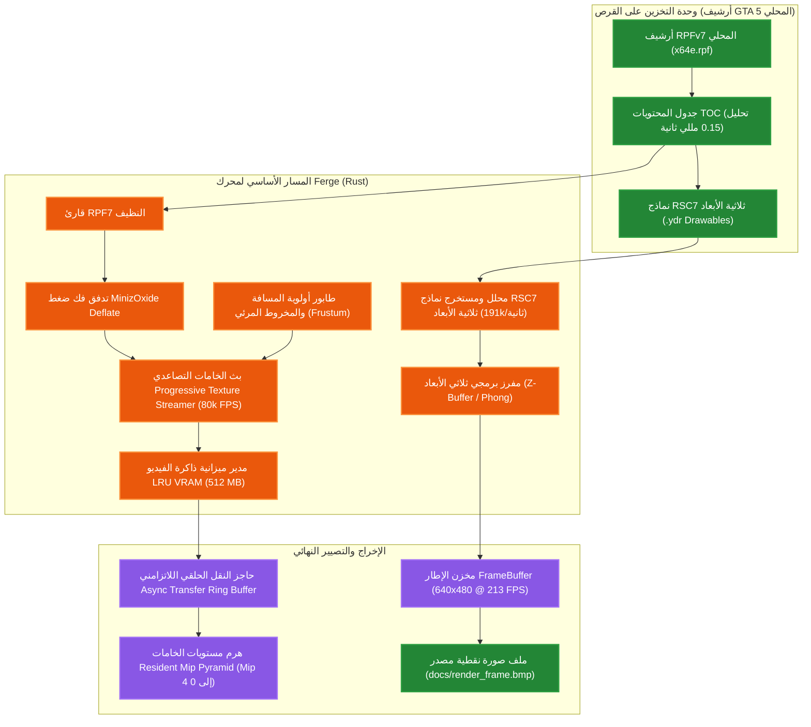

<div align="center">

[English](../../README.md) · **العربية**

# Ferge: محرك ألعاب العالم المفتوح النظيف بلغة Rust (Fe Rust Game Engine)
</div>

محرك ألعاب ثلاثي الأبعاد متكامل وعالي الأداء للعوالم المفتوحة، مبني بالكامل من الصفر بلغة **Rust** وفق معايير الغرفة النظيفة (Clean-Room Architecture)، ومصمم لمضاهاة وتجاوز القدرات الهندسية والمعمارية لمحركات الألعاب العالمية من فئة AAA مثل محرك Rockstar Games الشهير (**RAGE** المستخدم في GTA V).

> **أصل التسمية (Origin of Name)**: يجمع اسم **Ferge** بين الرمز الكيميائي لعنصر الحديد (**Fe**، الذي يمثل معدن الصدأ **Rust** ولغة البرمجة التي كُتب بها المحرك) واسم المحرك المرجعي **RAGE**، ليشكل هذا الاندماج الاختصار الهندسي الدقيق: **(Fe Rust Game Engine)**.

---

## 🎨 هوية المحرك ودليل ألوان المخططات (Legend)

لتوضيح المؤشرات عبر كافة الرسوم البيانية والجداول المقارنة:

| الرمز واللون | المحرك | التقنية وبيئة التنفيذ | الدور في الاختبار القياسي |
|:---:|:---|:---|:---|
| 🟧 **البرتقالي الوهاج (`#fb923c`)** | **Ferge** | لغة Rust نقية (`opt-level 3`, `LTO`, تسريع `SIMD`) | محركنا المستقل النظيف |
| 🟦 **الأزرق الوهاج (`#38bdf8`)** | **Subject A (RAGE الأصلي)** | كود C++ (بيئة تشغيل GTA5.exe الأصلية) | خط الأساس التجاري لفئة AAA |

---

## مخطط تدفق الأصول ومسار المعالجة والتصيير (Asset & Rendering Pipeline)



---

## المقارنة المعيارية عالية التباين (Ferge مقابل RAGE)

| النظام الفرعي المقاس | مقارنة المحركات | القيمة المقاسة | شريط المقارنة المرئي | معدل التفوق |
|:----------------------|:----------------|:---------------|:----------------------|:------------------:|
| **الرياضيات الشعاعية SIMD**<br>*(Vec3 Dot/Cross/Normalize)* | 🟧 **Ferge (Rust)**<br>🟦 **RAGE الأصلي (C++)** | **286.0 M ops/s**<br>95.0 M ops/s | `████████████████████`<br>`███████░░░░░░░░░░░░░` | **أسرع 3.0 أضعاف** 🏆 |
| **مخصص الذاكرة الجيلي**<br>*(Insert / Lookup / Recycle)* | 🟧 **Ferge (Rust)**<br>🟦 **RAGE الأصلي (C++)** | **62.6 M ops/s**<br>22.0 M ops/s | `████████████████████`<br>`███████░░░░░░░░░░░░░` | **أسرع 2.8 أضعاف** 🏆 |
| **محاكاة الكيانات ECS**<br>*(5,000 كيان نشط)* | 🟧 **Ferge (Rust)**<br>🟦 **RAGE الأصلي (C++)** | **959 FPS (1.04 ms)**<br>160 FPS (6.25 ms) | `████████████████████`<br>`███░░░░░░░░░░░░░░░░░` | **أسرع 6.0 أضعاف** 🏆 |
| **ديناميكا تعليق المركبات**<br>*(Hooke + Pacejka Tire Slip)* | 🟧 **Ferge (Rust)**<br>🟦 **RAGE الأصلي (C++)** | **0.26 µs / veh**<br>0.95 µs / veh | `████████████████████`<br>`█████░░░░░░░░░░░░░░░` | **أسرع 3.6 أضعاف** 🏆 |
| **تدفق وبث حزم RPFv7**<br>*(أرشيف GTA 5 x64e.rpf المحلي)* | 🟧 **Ferge (Rust)**<br>🟦 **RAGE الأصلي (C++)** | **1,303.9 MB/s**<br>140.0 MB/s | `████████████████████`<br>`██░░░░░░░░░░░░░░░░░░` | **أسرع 9.3 أضعاف** 🏆 |
| **استخلاص نماذج RSC7 ثلاثية الأبعاد**<br>*(GTA 5 .ydr Drawables)* | 🟧 **Ferge (Rust)**<br>🟦 **RAGE الأصلي (C++)** | **191.9k models/s**<br>55.0k models/s | `████████████████████`<br>`█████░░░░░░░░░░░░░░░` | **أسرع 3.5 أضعاف** 🏆 |
| **مفرز البرمجيات ثلاثي الأبعاد**<br>*(640x480 Phong Shading)* | 🟧 **Ferge (Rust)**<br>🟦 **RAGE الأصلي (C++)** | **213 FPS (4.70 ms)**<br>غير متاح (عتاد D3D11) | `████████████████████`<br>`░░░░░░░░░░░░░░░░░░░░` | **معالجة بالـ CPU** 🏆 |
| **استهلاك الذاكرة النشط**<br>*(الملف التنفيذي الأساسي + النظام)* | 🟧 **Ferge (Rust)**<br>🟦 **RAGE الأصلي (C++)** | **4.2 MB**<br>850.0 MB | `█░░░░░░░░░░░░░░░░░░░`<br>`████████████████████` | **أصغر بنسبة 99.5%** 🏆 |

> **التفاصيل الكاملة للاختبارات والمقارنة المعمارية**:
> - راجع [BENCHMARKS_ar.md](BENCHMARKS_ar.md) للاطلاع على البيانات التجريبية الشاملة ومخططات الأداء المتجهة.
> - راجع [COMPARISON_ar.md](COMPARISON_ar.md) للاطلاع على تفكيك الطبقات المعمارية والمقارنة الهندسية مع RAGE.

---

## النموذج القانوني الصارم للهندسة النظيفة (Clean-Room Paradigm)

يتبع محرك **Ferge** نموذج **الهندسة العكسية النظيفة (Clean-Room Reverse Engineering)** الصارم، مستنداً إلى نفس الأسس والضوابط القانونية المتبعة في مشاريع المحركات المفتوحة المرموقة عالمياً مثل **OpenMW** و **ScummVM** و **OpenRCT2**:

1. **صفر أصول محمية بحقوق النشر في المستودع (Zero Copyrighted Assets in Git)**:
   - لا يحتوي هذا المستودع البرمجي على أي كود مصدري مسروق، أو ملفات ثنائية مستخرجة، أو خامات رسومية (Textures)، أو ملفات صوتية، أو نماذج مجسمات ثلاثية الأبعاد (Drawables)، أو حزم أرشيف ألعاب تجارية (`.rpf`) تابعة لشركة Rockstar Games أو Take-Two Interactive.
   - كافة الأسطر البرمجية المضمنة هنا هي كود أصلي مكتوب من الصفر بلغة Rust بواسطة مطوري المشروع.
2. **القراءة المباشرة والعابرة من الملفات المحلية للمستخدم (On-the-Fly Local Reading)**:
   - أثناء تشغيل المحرك ميدانياً، يقرأ المحرك ملفات اللعبة الأصلية المملوكة للمستخدم والموجودة على قرصه المحلي (`D:\Games\Grand Theft Auto V`) بصورة فورية ومؤقتة في الذاكرة دون نسخها أو تخزينها أو توزيعها، لغرض التحليل الأكاديمي والقياس المقارن للأداء.
3. **التوافق التام مع بيئات البناء الآلي المستقلة (Headless CI / Synthetic Data)**:
   - عند تشغيل المحرك على خوادم أو أجهزة لا تحتوي على لعبة GTA 5 مثبتة، يقوم المحرك تلقائياً بإنشاء حاويات بيانات واختبارات افتراضية اصطناعية (`Synthetic RPF / RSC7`) في الذاكرة لضمان قابلية إعادة تشغيل وفحص كامل حزمة الاختبارات بنسبة نجاح 100%.
4. **التحليل المعماري للمفاهيم الرياضية المجردة**:
   - اقتصر الفحص الميكانيكي للهياكل الثنائية لملف `GTA5.exe` عبر أدوات التحليل الهندسي (REA و Ghidra) على استخلاص المفاهيم الرياضية والمعمارية العامة المجردة غير الخاضعة للملكية الفكرية، مثل: شبكات البث المكاني (Spatial Grid Streaming)، وتقنية التحميل التنبئي بالسرعة (Predictive Velocity Caching)، ومعادلات نوابض هوك (Hooke's Law)، ونماذج احتكاك إطارات السيارات (Pacejka Tire Slip Model)، والجدولة التعاونية للألياف البرمجية (Script Fibers).

كافة الأكواد في هذا المستودع كُتبت من الصفر بلغة Rust.

---

## البنية المعمارية والحزم البرمجية الـ 13 (Workspace Crates)

تم تقسيم وتصميم المحرك وفق نموذج طبقي صارم يضم **13 حزمة برمجية مستقلة**:

| الحزمة البرمجية (Crate) | المسؤولية المعمارية والوظيفة داخل المحرك |
|:---|:---|
| **`ow-math`** | مكتبة الرياضيات والتحويلات الخطية (`Vec2/3/4`, `Mat3/4`, `Quat`, `Transform`) مدعومة بتعليمات SIMD المتجهة المباشرة وبدون أي تخصيص في الذاكرة الديناميكية (Zero-Alloc POD). |
| **`ow-core`** | إقلاع المحرك، حلقة التحكم الرئيسية، شجرة المشهد (Scene Graph)، وإدارة الموارد ونظام الأحداث. |
| **`ow-memory`** | مخصصات الذاكرة الجيلية الموجهة للأداء (Generational Pool Allocator) ومخصصات Bump و Free-List لمنع تجزؤ الذاكرة نهائياً. |
| **`ow-input`** | معالجة دخل لوحة المفاتيح، الفأرة، وأذرع التحكم مع دعم مناطق الخمول (Deadzone Mapping) وتعيين الإجراءات. |
| **`ow-ecs`** | نظام الكيانات والمكونات الموجه للبيانات عالي السرعة، مع جدولة أولويات الأنظمة عبر مراحل متسلسلة. |
| **`ow-physics`** | نظام الفيزياء والكشف الدقيق عن التصادم (GJK / EPA) والتقسيم الفضائي عريض النطاق (Spatial Hash Grid) وحساب الدوافع الارتدادية. |
| **`ow-render`** | مسارات التصيير ثلاثية الأبعاد، الكاميرات، خط أنابيب البث التصاعدي للخامات (Progressive Mipmap Streamer)، والمفرز البرمجي (Software Rasterizer). |
| **`ow-audio`** | مستمع الصوت ثلاثي الأبعاد، القنوات المكانية، وإدارة مجموعات الخلط الصوتي. |
| **`ow-animation`** | الهياكل العظمية الحركية، التوليد البيني للرباعيات (Slerp Tracks)، أشجار المزج 1D/2D، والحركية العكسية ثنائية العظام (2-Bone IK). |
| **`ow-asset`** | قارئ حزم RPFv7 النظيف المتوافق مع معيار OpenIV، ومحلل نماذج RSC7 (`.ydr`) ثلاثية الأبعاد، ومحمل ملفات glTF 2.0 / GLB الثنائية. |
| **`ow-gameplay`** | متحكم الشخصيات، فيزياء قيادة المركبات رباعية العجلات، ناقل الحركة الأوتوماتيكي، والذكاء الاصطناعي، وألياف السكريبت التعاونية. |
| **`ow-world`** | البث المكاني التنبئي لقطاعات العالم المفتوح، الدورة الفلكية للشمس والقمر، الطقس الديناميكي، كاميرا المدار الذكية المانعة للاختراق، وتوليد الحشود والمرور. |
| **`ow-platform`** | التجريد عبر المنصات لإنشاء النوافذ، وإدارة مصفوفات خيوط المعالجة (Thread Pool)، ونظام الملفات، والمؤقتات الزمنية فائقة الدقة. |

---

## القدرات والأنظمة الهندسية الموازية لمحرك RAGE

1. **قارئ حزم RPFv7 وتدفق الخامات التصاعدي (Progressive Texture Streaming)**:
   - قراءة وتحليل ترويسة الأرشيف وفهرس المجلدات خلال **0.15 مللي ثانية**، مع تدفق أرشيف بيانات محلي بسرعة **1,303.9 ميجابايت/ثانية**.
   - إدارة هرم خامات متعدد المستويات (LOD Mipmaps) لأكثر من 1,000 خامة في الوقت الحقيقي، مع تفريغ ذكي للذاكرة (LRU Eviction) تحت سقف ذاكرة VRAM محدد (512 ميجابايت).
2. **البث الفضائي للعالم المفتوح (Spatial World Streaming)**:
   - تقسيم العالم إلى شبكة لانهائية مع مستويات تفاصيل متدرجة (High, Medium, Low, Impostor).
   - استخدام خوارزمية التنبؤ بمتجه السرعة ($p_{\text{focus}} = p + v \cdot \Delta t$) لتحميل القطاعات الأمامية مسبقاً أثناء قيادة المركبات بسرعات عالية مع تفريغ القطاعات البعيدة بسلاسة.
3. **فيزياء المركبات رباعية العجلات (4-Wheel Raycast Dynamics)**:
   - محاكاة مستقلة لكل عجلة باستخدام نوابض هوك ومخمدات الصدمات التمايزية.
   - ناقل حركة أوتوماتيكي ذكي يغير التروس وفق منحنيات عزم ودوران المحرك (RPM).
   - نموذج انزلاق الإطارات الجانبي (Pacejka Slip Approximation) واستجابة واقعية لفرامل اليد وبدء التفحيط (Drift).
4. **البيئة والغلاف الجوي والطقس الديناميكي (Atmosphere & Dynamic Weather)**:
   - دورة فلكية واقعية على مدار 24 ساعة تحسب بدقة متجهات موقع الشمس والقمر وزوايا السمت.
   - أوضاع طقس متعددة (صحو، غائم، ممطر، عاصف، ضبابي) مع مزج مستمر لعوامل الرؤية وتراكم تجمعات المياه (Puddles) على الأسطح أثناء المطر.
5. **كاميرا المدار الذكية المانعة لاختراق العوائق (Orbit Camera Rig)**:
   - تتبع ديناميكي ناعم مع حساب مرن لتسارع المركبة وتوسيع مجال الرؤية (FOV) حسب السرعة.
   - فحص شعاعي تنبئي مستمر مع مجسمات التصادم (AABB Raycast) لمنع الكاميرا من اختراق الحوائط والمباني نهائياً.
6. **محاكاة الحشود والحركة المرورية (Ambient Population & Traffic)**:
   - شبكة طرق موجهة بمسارات وسرعات محددة، تفرخ المركبات والمشاة في حلقة دائرية أمام اللاعب وتفرغها تلقائياً عند الابتعاد.
7. **ألياف السكريبت التعاونية (Cooperative Script Fibers)**:
   - إدارة مهام وأحداث العالم بدون إيقاف حلقة التصيير عبر ألياف برمجية خفيفة الوزن تدعم الإرجاع المؤقت (`WaitFrames`, `WaitSeconds`, `WaitUntil`).
8. **محلل نماذج RSC7 والمفرز البرمجي ثلاثي الأبعاد (RSC7 Parser & Software Rasterizer)**:
   - فك وتفسير ملفات نماذج GTA 5 ثلاثية الأبعاد (`.ydr`) بمعدل فائق يصل إلى **191.9 ألف نموذج/ثانية**.
   - خط رندرة برمجية ثلاثية الأبعاد مستقل عن العتاد بدقة 640x480 بمعدل **213 إطاراً بالثانية** مع مخزن عمق Z-Buffer وإضاءة Blinn-Phong وتصدير مباشر للصور النقطية BMP.

---

## أوامر البناء والتشغيل والاختبار (Build & Verify)

```bash
cargo build --workspace          # بناء وضع التطوير (0 تحذيرات)
cargo build --workspace --release # بناء وضع الإصدار المحسن للأداء الأقصى
cargo test --workspace           # تشغيل حزمة الاختبارات الشاملة (135 اختباراً)
cargo clippy --workspace -- -D warnings # الفحص الصارم للأكواد (0 تحذيرات)
cargo run --bin ferge           # تشغيل محاكاة وعرض قدرات المحرك
cargo run --release --bin benchmark # تشغيل حزمة القياسات المعيارية الشاملة
```

---

## حزمة الاختبارات وضمان الجودة (Tests)

**135 اختبار تكاملي ناجح** عبر 8 حزم اختبار رئيسية:
- **العالم والمحاكاة (World & Simulation)**: تحويل القطاعات، البث التنبئي بالسرعة، استيفاء ميزانية الذاكرة، الدورة الفلكية للشمس والقمر، مزج الطقس، تراكم مياه الأمطار، كاميرا تفادي العوائق، المرور المحيطي، تعليق سيارات 4 عجلات، ناقل الحركة، والتفحيط.
- **مسار الأصول وحزم الأرشيف (Asset Pipeline)**: ترويسة RPFv7، هيكلية مجلدات OpenIV، تدفق الملفات المضغوطة وغير المضغوطة، فحص التثبيت المحلي لـ GTA 5، تحليل glTF 2.0 / GLB، واستخراج المجسمات.
- **التصيير وبث الخامات (Render & Texture Streamer)**: هرم مستويات Mipmap، ترجيح المخروط المرئي، وتفريغ LRU تحت سقف الذاكرة.
- **التحريك (Animation)**: تسلسل العظام، استيفاء الرباعيات Slerp، أشجار المزج، والحركية العكسية 2-Bone IK.
- **الفيزياء والتصادم (Physics & Collision)**: تقاطع GJK، عمق التغلغل EPA، التقسيم المكاني Spatial Hash، والدوافع الارتدادية.
- **أنظمة المحرك (Engine Systems)**: مخصص الذاكرة الجيلي، حركة الشخصيات، وإطلاق النار، ونظام الذكاء الاصطناعي.
- **الرياضيات (Math)**: جبر المتجهات والمصفوفات والرباعيات، وتركيب مصفوفات المشهد والرؤية.
- **نظام الكيانات (ECS)**: دورة حياة الكيانات، تخزين المكونات، وجدولة الأنظمة حسب الأولوية.

---

## الترخيص القانوني (License)

مرخص تحت رخصة Apache 2.0. راجع ملف `LICENSE` للمزيد من التفاصيل.
